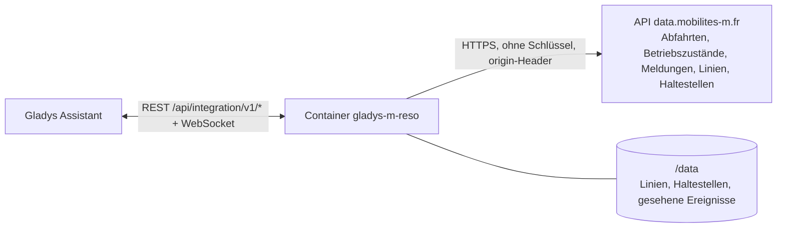
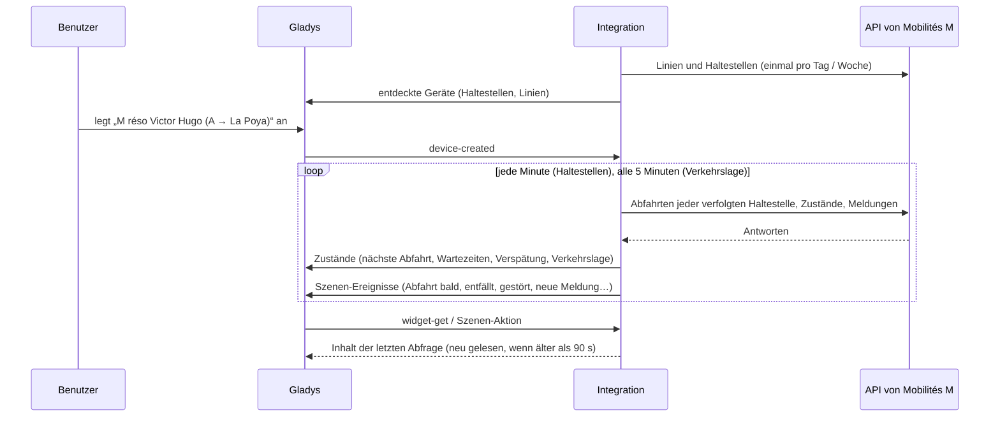
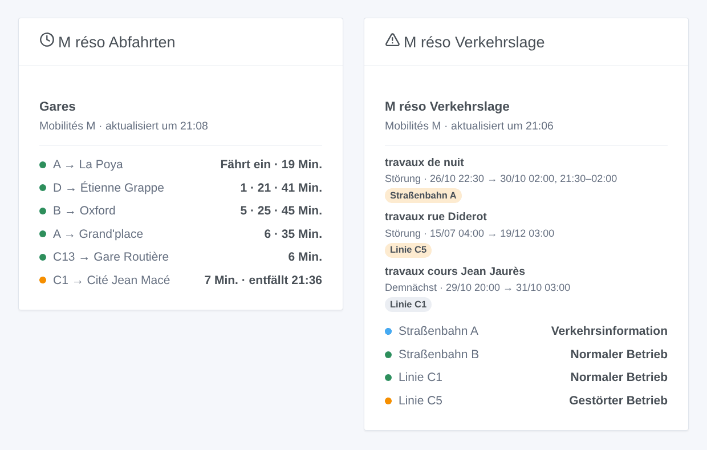

# Gladys M réso

[English](README.md) · [Français](README.fr.md) · **Deutsch** · [Español](README.es.md)

[](LICENSE)
[](https://github.com/William-De71/gladys-m-reso/releases)
[](https://github.com/William-De71/gladys-m-reso/actions/workflows/release.yml)
[](https://gladysassistant.com)


Externe Integration für [Gladys Assistant](https://gladysassistant.com) für **M réso**, die Straßenbahnen und Busse von Grenoble: die nächsten Abfahrten in Echtzeit an deinen Haltestellen, mit ihrer Verspätung und den ausfallenden Fahrten, und die Verkehrslage deiner Linien, mit Szenen und Dashboard-Widgets. Sie liest die offiziellen Open Data von Mobilités M (SMMAG), ohne Konto und ohne Schlüssel.

Benutzerdokumentation: [English](docs/en.md) · [Français](docs/fr.md) · [Deutsch](docs/de.md) · [Español](docs/es.md).

> Community-Integration, weder mit dem SMMAG, M réso noch den Betreibern der Netze von Mobilités M verbunden oder von ihnen unterstützt.

## Funktionen

- **Ein Gerät pro verfolgter Haltestelle** (drei im Formular, bis zu 10 weitere über die Schaltfläche **Haltestelle hinzufügen**), per Name — mit Ort, wenn zwei Orte ihn teilen — oder per Code eingegeben und nach **Linie** und **Richtung** gefiltert: nächste Abfahrt, Wartezeit der nächsten zwei Abfahrten, Verspätung der nächsten.
- **Ein Gerät pro verfolgter Linie** (bis zu sechs), M réso und die anderen Netze von Mobilités M (Cars Région, Pays Voironnais, Grésivaudan…): ihr Betriebszustand (normal, Verkehrsinformation, gestört, stark gestört) und die aktuellen Verkehrsmeldungen.
- **Echtzeit**: die geschätzte Zeit und die Verspätung, wenn das Fahrzeug verfolgt wird, sonst der Fahrplan (als solcher gekennzeichnet), die ausfallenden Fahrten.
- **5 Szenen-Auslöser**, **2 Szenen-Aktionen** und **2 Dashboard-Widgets** (siehe unten).
- Eine Anfrage pro verfolgter Haltestelle, standardmäßig jede Minute (30 s bis 5 min, nachts alle 10 min, wenn nichts angekündigt ist), Verkehrslage alle 5 Minuten; Linien und Haltestellen der Netze in `/data` gespeichert.
- Konfigurationsschaltflächen: Verbindung testen, Haltestelle suchen (Ort, Code, Linien), Haltestellen hinzufügen / entfernen / auflisten, Diagnose.
- Überall vier Sprachen: Englisch, Französisch, Deutsch, Spanisch.

## Funktionsweise




Beim Start liest die Integration die Linien (`/routers/default/index/routes`) und die Haltestellen (`/points/json?types=clusters`, die „zones d’arrêt“: ein Name in einem Ort) aller Netze der Region. Dann löst sie deine Eingaben auf: „A“ ist die Straßenbahnlinie `SEM:A`, „C1“ die Chrono-Linie von M réso (der TER „C1“ über seinen Code), „Chavant“ die Haltestelle `SEM:GENCHV`. Danach liest sie die nächsten Abfahrten jeder verfolgten Haltestelle (`/clusters/<code>/stoptimes`, ausfallende Fahrten inklusive) nach eigenem Takt, eine Anfrage pro Haltestelle, und behält die der gewählten Linie und Richtung; alle 5 Minuten liest sie die Betriebszustände (`/dyn/ligne/json`) und die Verkehrsmeldungen (`/dyn/evtTC/json`). Jede Abfrage wird mit der vorherigen verglichen, um die Szenen-Auslöser auszulösen.



### Transport

Nur Cloud (`"transports": ["cloud"]`): Der Katalog zeigt das Cloud-Abzeichen. Die Integration kontaktiert `data.mobilites-m.fr`; nur die verfolgten Haltestellen werden abgefragt. Es gibt keine lokale Alternative, daher keine Schaltfläche „Lokale Verbindung bevorzugen“.

## Geräte und Funktionen

| Gerät                      | Funktion                           | Kategorie / Typ              | Werte                                       |
| -------------------------- | ---------------------------------- | ---------------------------- | ------------------------------------------- |
| M réso \<Haltestelle\>     | Nächste Abfahrt                    | `text` / `text`              | „A → La Poya · 3 Min. (+2 Min. Verspätung)“ |
| M réso \<Haltestelle\>     | Wartezeit, Wartezeit der folgenden | `duration` / `integer`       | 0 … 180 Min.                                |
| M réso \<Haltestelle\>     | Verspätung der nächsten Abfahrt    | `duration` / `integer`       | 0 … 120 Min.                                |
| M réso Straßenbahn / Linie | Verkehrslage                       | `text` / `text`              | „Gestörter Betrieb: travaux rue Diderot“    |
| M réso Straßenbahn / Linie | Aktuelle Verkehrsmeldungen         | `counter-sensor` / `integer` | 0 … 20                                      |

Nachts, ohne Abfahrt, behalten die Wartezeiten ihren letzten Wert (eine 0 würde eine Straßenbahn jetzt ankündigen); die Verspätung wird nur für eine in Echtzeit verfolgte Abfahrt veröffentlicht.

## Szenen-Auslöser, Aktionen und Widgets



**Szenen-Auslöser** (einmal pro Übergang; die erste Abfrage ist eine Referenz und löst nichts aus):

- **Abfahrt bald**: eine Abfahrt an einer verfolgten Haltestelle fährt in 2, 3, 5, 10, 15 oder 20 Minuten, nach ihrer Echtzeit-Schätzung. Filter: Haltestelle, Minuten.
- **Abfahrt entfällt**: eine Fahrt der nächsten Stunde an einer verfolgten Haltestelle fällt aus. Filter: Haltestelle.
- **Linie gestört**: der Betriebszustand einer verfolgten Linie wird gestört oder stark gestört. Filter: Linie.
- **Wieder normal**: die Linie hat wieder einen normalen Betriebszustand. Filter: Linie.
- **Neue Verkehrsmeldung**: Mobilités M veröffentlicht eine Meldung zu einer verfolgten Linie, aktuell oder demnächst. Filter: Linie, Art (Information, Störung, starke Störung).

**Szenen-Aktionen**: **nächste Abfahrten** einer Haltestelle (Linie, Ziel, Wartezeit, Zeit, Echtzeit oder nicht, Verspätung, die folgende, ein Satz) und **Verkehrslage einer Linie** (Zustand, Meldungen, letzte Meldung, ein Satz).

**Widgets**: **M réso Abfahrten** (eine verfolgte Haltestelle, mehrere in einer Liste oder eine beliebige in den Einstellungen eingegebene Haltestelle) und **M réso Verkehrslage** (die verfolgten Linien, die eingegebenen oder standardmäßig die fünf Straßenbahnlinien).

Beispiele:

- Wenn **die Straßenbahn A Richtung La Poya in 5 Minuten an Victor Hugo abfährt** → die Flurlampe grün schalten.
- Wenn **eine Abfahrt deiner Haltestelle entfällt** oder **die C1 gestört ist** → `{{triggerEvent.data.summary}}` aufs Handy schicken.
- Jeden Werktag um 7:30 → **die nächsten Abfahrten lesen** und die `summary` vom Küchenlautsprecher ansagen lassen.

## Voraussetzungen

- Gladys Assistant **5.3.0** oder neuer (Widgets und Szenen-Auslöser externer Integrationen, Stichwörter und Länder des Katalogs von Gladys 5.3). Ältere Instanzen können die Integration nicht installieren.
- Sonst nichts: Die Open Data von Mobilités M brauchen weder Konto noch Schlüssel.

## Installation

- **Aus dem Store** von Gladys (Integrationen → Externe Integrationen), mit einem Klick, sobald indexiert.
- **Über die Repository-URL**: `https://github.com/William-De71/gladys-m-reso`.
- **Entwicklermodus**: das Image lokal bauen (`docker build -t gladys-m-reso .`) und aus Gladys installieren.

## Konfiguration

| Feld                     | Beschreibung                                                                  |
| ------------------------ | ----------------------------------------------------------------------------- |
| Haltestelle (1 bis 3)    | Ein Name („Chavant“, „Grenoble Hôtel de Ville“) oder ein Code („SEM:GENCHV“). |
| Linie                    | „A“, „C1“, „16“. Leer: alle Linien der Haltestelle.                           |
| Richtung                 | Wörter des Ziels: „La Poya“, „Fontaine \| Seyssins“. Leer: beide.             |
| Verfolgte Linien         | Bis zu sechs, durch Kommas getrennt: „A, B, C1, 16“.                          |
| Abfrage der Haltestellen | 30 s, 1 min (Standard), 2 min oder 5 min.                                     |
| Sprache der Texte        | Gerätenamen, Zusammenfassungen und Ausgaben der Szenen.                       |

Schaltflächen: **Verbindung testen**, **Haltestelle suchen** (Ort, Code und Linien jeder gefundenen Haltestelle), **Haltestelle hinzufügen**, **Haltestelle entfernen**, **Haltestellen auflisten** (die Haltestellen über die drei des Formulars hinaus, in der Konfiguration von Gladys gespeichert) und **Diagnose** (schreibt Haltestellen, Linien, letzte Abfahrten, Fehler und Anfragen in den Tab Protokolle).

## Verwendung

1. Gib eine bis drei Haltestellen ein — mehr mit **Haltestelle hinzufügen** — (auf Wunsch mit Linie und Richtung) und die zu verfolgenden Linien, dann speichern.
2. Lege im Tab **Entdecken** die Geräte „M réso …“ an.
3. Füge die Widgets **M réso Abfahrten** und **M réso Verkehrslage** zu einem Dashboard hinzu und baue Szenen mit den Auslösern oben.

## Entwicklung

```bash
npm install
npm test                       # node --test, berührt nie das Netz
npm run lint && npm run format:check
npx github:GladysAssistant/integration-store . --skip-image-check
scripts/build-cover.sh         # cover.jpg aus docs/assets/cover.svg
docs/illustrations/render.sh   # docs/assets/widgets.<Sprache>.png
node .github/scripts/release.mjs next
```

Lokal liest das SDK `GLADYS_HOST_API_URL`, `GLADYS_INTEGRATION_TOKEN` und `GLADYS_INTEGRATION_SELECTOR`; `MRESO_API_URL` leitet die Integration auf eine andere API-Wurzel um (ein Mock); `DEBUG=gladys-integration-sdk` zeigt die SDK-Protokolle und prüft jeden Widget-Inhalt. Die Tests nutzen echte, gekürzte Antworten der API von Mobilités M (`test/fixtures/`, ODbL). Die Regeln des Projekts stehen in [CLAUDE.md](CLAUDE.md).

## Release-Prozess


Jeder Merge auf `main` startet die CI und berechnet dann die Version aus den [Conventional Commits](https://www.conventionalcommits.org/) seit dem letzten Tag: `feat` → Minor, `fix` / `perf` → Patch, `!` oder `BREAKING CHANGE` → Major (ein Minor unter 1.0.0); `docs`, `chore`, `ci`, `test`, `style`, `refactor`, `build` allein veröffentlichen nichts. Der Changelog-Abschnitt wird erzeugt, der Tag gepusht, das Multi-Architektur-Image gebaut, dann erhält `main` den Release-Commit, die GitHub Release wird erstellt und ein letzter Job prüft das öffentliche Image, den Store-Validator und das Topic.

- Der Titel des Pull Requests wird zum Squash-Commit und dann zur Changelog-Zeile: schreibe ihn auf Englisch, für die Nutzer (`pr-title.yml` prüft ihn). `CHANGELOG.md` nie von Hand bearbeiten.
- 1.0.0 ist eine Entscheidung: Actions → Release → Run workflow mit `release-as: 1.0.0`. `dry-run` zeigt Version und Notizen, ohne etwas zu veröffentlichen.
- **Geschützter Branch**: Die Release pusht ihren Commit mit `GITHUB_TOKEN` auf `main`. Mit einem Ruleset auf `main`, das strenger ist als „kein Löschen, kein Force-Push“, füge GitHub Actions zur Bypass-Liste hinzu (oder pushe über eine GitHub App), sonst scheitert der Veröffentlichungs-Job mit Anweisungen.
- Nach der ersten Release das Paket auf `ghcr.io` öffentlich machen (Package settings → Change visibility), sonst kann Gladys es nicht laden.

## Fehlerbehebung

Siehe [docs/de.md](docs/de.md#fehlerbehebung). Melde Probleme mit den Versionen von Gladys und der Integration, der betroffenen Haltestelle oder Linie und den Zeilen der Schaltfläche **Diagnose**.

## Mitwirken

Issues und Pull Requests sind willkommen. Führe `npm run format:check && npm run lint && npm test` vor einem Pull Request aus und ändere keine externe ID und keinen gespeicherten Schlüssel (siehe [CLAUDE.md](CLAUDE.md)).

## Sicherheit

Siehe [SECURITY.md](SECURITY.md): Schwachstellen bitte vertraulich melden. Die Integration braucht kein Geheimnis: Sie liest nur öffentliche Open Data und läuft schreibgeschützt, als Nicht-Root-Benutzer, in ihrem Container.

## Kommende Screenshots

Die Bilder oben sind Illustrationen, keine Screenshots. Echte Screenshots kommen in `docs/assets/screenshots/` (PNG, 1280 × 800): `configuration.png`, `discovery.png`, `device.png`, `scene.png`.

## Lizenz

[Apache License 2.0](LICENSE) — siehe auch [NOTICE](NOTICE). Die Abfahrten, Linien, Haltestellen, Betriebszustände und Verkehrsmeldungen sind Open Data von Mobilités M (SMMAG) unter der [Open Database License (ODbL)](https://opendatacommons.org/licenses/odbl/1-0/): Die Widgets zeigen die Quelle und die Zeit jeder Abfrage. Danke an die Dokumentation und das SDK von Gladys und an den SMMAG für die Veröffentlichung dieser Daten in Echtzeit.
