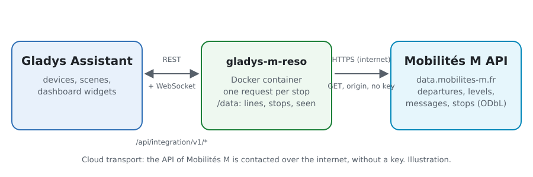
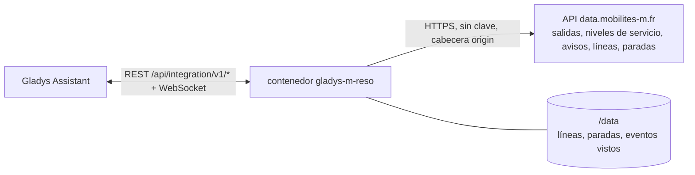
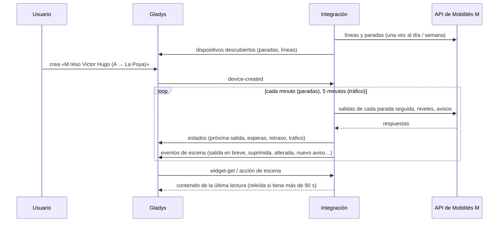
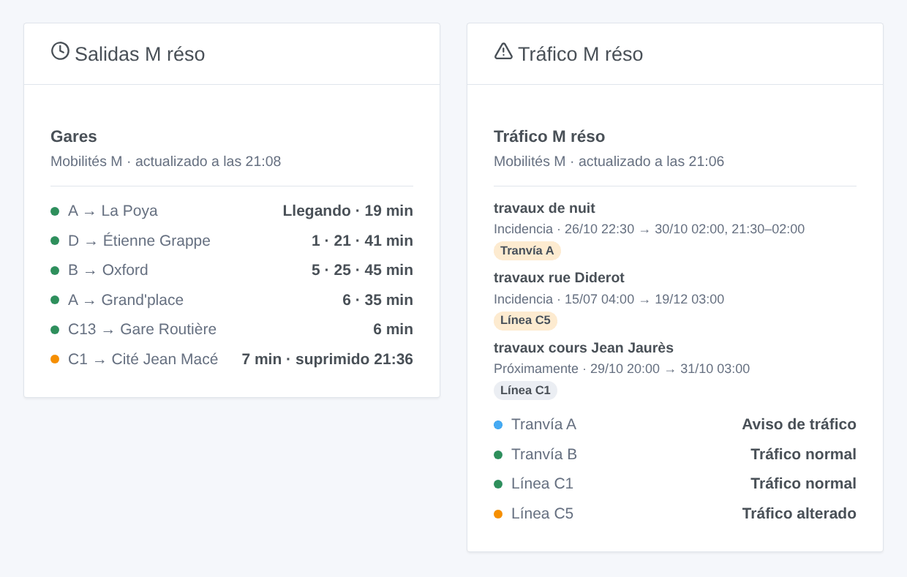

# Gladys M réso

[English](README.md) · [Français](README.fr.md) · [Deutsch](README.de.md) · **Español**

[](LICENSE)
[](https://github.com/William-De71/gladys-m-reso/releases)
[](https://github.com/William-De71/gladys-m-reso/actions/workflows/release.yml)
[](https://gladysassistant.com)


Integración externa de [Gladys Assistant](https://gladysassistant.com) para **M réso**, los tranvías y autobuses de Grenoble: las próximas salidas en tiempo real en tus paradas, con su retraso y los viajes suprimidos, y el tráfico de tus líneas, con escenas y widgets de panel. Lee los datos abiertos oficiales de Mobilités M (SMMAG), sin cuenta ni clave.

Documentación de usuario: [English](docs/en.md) · [Français](docs/fr.md) · [Deutsch](docs/de.md) · [Español](docs/es.md).

> Integración comunitaria, no afiliada ni respaldada por el SMMAG, M réso o los operadores de las redes de Mobilités M.

## Funciones

- **Un dispositivo por parada seguida** (tres en el formulario, hasta 10 más con el botón **Añadir una parada**), escrita por su nombre — con su municipio cuando dos municipios lo comparten — o por su código, y filtrada por **línea** y **dirección**: próxima salida, espera de las dos próximas salidas, retraso de la próxima.
- **Un dispositivo por línea seguida** (hasta seis), M réso y las demás redes de Mobilités M (Cars Région, Pays Voironnais, Grésivaudan…): su nivel de servicio (normal, aviso de tráfico, alterado, muy alterado) y los avisos de tráfico en curso.
- **Tiempo real**: la hora estimada y el retraso cuando se sigue el vehículo, el horario teórico si no (indicado como tal), los viajes suprimidos.
- **5 disparadores de escena**, **2 acciones de escena** y **2 widgets** (abajo).
- Una petición por parada seguida, cada minuto por defecto (30 s a 5 min, cada 10 min de noche cuando no se anuncia nada), tráfico cada 5 minutos; líneas y paradas de las redes guardadas en `/data`.
- Botones de configuración: probar la conexión, buscar una parada (municipio, código, líneas), añadir / quitar / listar paradas, diagnóstico.
- Cuatro idiomas en todo: inglés, francés, alemán, español.

## Funcionamiento





Al arrancar, la integración lee las líneas (`/routers/default/index/routes`) y las paradas (`/points/json?types=clusters`, las «zones d’arrêt»: un nombre en un municipio) de todas las redes del territorio. Luego resuelve lo que escribiste: «A» es la línea de tranvía `SEM:A`, «C1» la Chrono de M réso (el TER «C1» por su código), «Chavant» la parada `SEM:GENCHV`. Después lee las próximas salidas de cada parada seguida (`/clusters/<código>/stoptimes`, viajes suprimidos incluidos) a su propio ritmo, una petición por parada, y conserva las de la línea y la dirección elegidas; cada 5 minutos lee los niveles de servicio (`/dyn/ligne/json`) y los avisos de tráfico (`/dyn/evtTC/json`). Cada lectura se compara con la anterior para lanzar los disparadores de escena.



### Transporte

Solo cloud (`"transports": ["cloud"]`): el catálogo muestra la insignia cloud. La integración contacta con `data.mobilites-m.fr`; solo se piden las paradas seguidas. No hay alternativa local, así que no hay botón «Preferir la conexión local».

## Dispositivos y funciones

| Dispositivo            | Función                      | Categoría / tipo             | Valores                                   |
| ---------------------- | ---------------------------- | ---------------------------- | ----------------------------------------- |
| M réso \<parada\>      | Próximo paso                 | `text` / `text`              | «A → La Poya · 3 min (+2 min de retraso)» |
| M réso \<parada\>      | Espera, espera del siguiente | `duration` / `integer`       | 0 … 180 min                               |
| M réso \<parada\>      | Retraso del próximo paso     | `duration` / `integer`       | 0 … 120 min                               |
| M réso tranvía / línea | Tráfico                      | `text` / `text`              | «Tráfico alterado: travaux rue Diderot»   |
| M réso tranvía / línea | Avisos de tráfico en curso   | `counter-sensor` / `integer` | 0 … 20                                    |

De noche, sin ninguna salida, las esperas conservan su último valor (un 0 anunciaría un tranvía ahora); el retraso solo se publica para una salida seguida en tiempo real.

## Disparadores, acciones y widgets



**Disparadores de escena** (una vez por transición; la primera lectura es una referencia y no dispara nada):

- **Salida en breve**: una salida en una parada seguida sale dentro de 2, 3, 5, 10, 15 o 20 minutos, según su estimación en tiempo real. Filtros: parada, minutos.
- **Salida suprimida**: un viaje de la próxima hora en una parada seguida queda suprimido. Filtro: parada.
- **Línea alterada**: el nivel de servicio de una línea seguida pasa a alterado o muy alterado. Filtro: línea.
- **Fin de la incidencia**: la línea vuelve a un nivel de servicio normal. Filtro: línea.
- **Nuevo aviso de tráfico**: Mobilités M publica un aviso sobre una línea seguida, en curso o próximo. Filtros: línea, tipo (información, incidencia, incidencia grave).

**Acciones de escena**: **próximas salidas** de una parada (línea, destino, espera, hora, tiempo real o no, retraso, la siguiente, una frase) y **tráfico de una línea** (estado, avisos, último aviso, una frase).

**Widgets**: **Salidas M réso** (una parada seguida, varias en una misma lista, o cualquier parada escrita en los ajustes) y **Tráfico M réso** (las líneas seguidas, las escritas, o las cinco líneas de tranvía por defecto).

Ejemplos:

- Cuando **el tranvía A hacia La Poya sale de Victor Hugo dentro de 5 minutos** → encender en verde la lámpara de la entrada.
- Cuando **se suprime una salida de tu parada** o **la C1 está alterada** → enviar `{{triggerEvent.data.summary}}` a tu teléfono.
- Cada día laborable a las 7:30 → **leer las próximas salidas** de tu parada y hacer que el altavoz de la cocina diga el `summary`.

## Requisitos

- Gladys Assistant **5.3.0** o posterior (widgets y disparadores de escena de las integraciones externas, palabras clave y países del catálogo de Gladys 5.3). Las instancias más antiguas no pueden instalar la integración.
- Nada más: los datos abiertos de Mobilités M no piden cuenta ni clave.

## Instalación

- **Desde la tienda** de Gladys (Integraciones → Integraciones externas), con un clic, una vez indexada.
- **Desde la URL del repositorio**: `https://github.com/William-De71/gladys-m-reso`.
- **Modo desarrollador**: construir la imagen en local (`docker build -t gladys-m-reso .`) e instalarla desde Gladys.

## Configuración

| Campo                  | Descripción                                                                  |
| ---------------------- | ---------------------------------------------------------------------------- |
| Parada (1 a 3)         | Un nombre («Chavant», «Grenoble Hôtel de Ville») o un código («SEM:GENCHV»). |
| Línea                  | «A», «C1», «16». Vacío: todas las líneas de la parada.                       |
| Dirección              | Palabras del destino: «La Poya», «Fontaine \| Seyssins». Vacío: ambos.       |
| Líneas seguidas        | Hasta seis, separadas por comas: «A, B, C1, 16».                             |
| Lectura de las paradas | 30 s, 1 min (por defecto), 2 min o 5 min.                                    |
| Idioma de los textos   | Nombres de los dispositivos, resúmenes y salidas de las escenas.             |

Botones: **Probar la conexión**, **Buscar una parada** (municipio, código y líneas de cada parada encontrada), **Añadir una parada**, **Quitar una parada**, **Listar las paradas** (las paradas más allá de las tres del formulario, guardadas en la configuración de Gladys) y **Diagnóstico** (escribe las paradas, líneas, últimas salidas, errores y peticiones en la pestaña Registros).

## Uso

1. Escribe de una a tres paradas — más con **Añadir una parada** — (con su línea y dirección si quieres) y las líneas a seguir, y guarda.
2. En la pestaña **Descubrir**, crea los dispositivos «M réso …».
3. Añade los widgets **Salidas M réso** y **Tráfico M réso** a un panel, y crea escenas con los disparadores de arriba.

## Desarrollo

```bash
npm install
npm test                       # node --test, nunca toca la red
npm run lint && npm run format:check
npx github:GladysAssistant/integration-store . --skip-image-check
scripts/build-cover.sh         # cover.jpg desde docs/assets/cover.svg
docs/illustrations/render.sh   # docs/assets/widgets.<idioma>.png
node .github/scripts/release.mjs next
```

En local, el SDK lee `GLADYS_HOST_API_URL`, `GLADYS_INTEGRATION_TOKEN` y `GLADYS_INTEGRATION_SELECTOR`; `MRESO_API_URL` dirige la integración a otra raíz de API (un simulador); `DEBUG=gladys-integration-sdk` muestra los registros del SDK y comprueba cada contenido de widget. Las pruebas usan respuestas reales de la API de Mobilités M, reducidas (`test/fixtures/`, ODbL). Las reglas del proyecto están en [CLAUDE.md](CLAUDE.md).

## Proceso de release


Cada fusión en `main` lanza la CI y luego calcula la versión a partir de los [Conventional Commits](https://www.conventionalcommits.org/) desde la última etiqueta: `feat` → menor, `fix` / `perf` → parche, `!` o `BREAKING CHANGE` → mayor (una menor por debajo de 1.0.0); `docs`, `chore`, `ci`, `test`, `style`, `refactor`, `build` solos no publican nada. Se genera la sección del changelog, se sube la etiqueta, se construye la imagen multiarquitectura, luego `main` recibe el commit de release, se crea la GitHub Release y un último job comprueba la imagen pública, el validador de la tienda y el topic.

- El título de la pull request se convierte en el commit squash y luego en la línea del changelog: escríbelo en inglés, para el usuario (`pr-title.yml` lo comprueba). No edites nunca `CHANGELOG.md` a mano.
- 1.0.0 es una decisión: Actions → Release → Run workflow con `release-as: 1.0.0`. `dry-run` muestra la versión y las notas sin publicar nada.
- **Rama protegida**: la release sube su commit a `main` con `GITHUB_TOKEN`. Con un ruleset en `main` más estricto que «sin borrado, sin force-push», añade GitHub Actions a su lista de excepciones (o sube mediante una GitHub App); si no, el job de publicación falla con instrucciones.
- Tras la primera release, haz público el paquete de `ghcr.io` (Package settings → Change visibility), o Gladys no podrá descargarlo.

## Solución de problemas

Ver [docs/es.md](docs/es.md#solución-de-problemas). Informa de los problemas con las versiones de Gladys y de la integración, la parada o línea afectada y las líneas del botón **Diagnóstico**.

## Contribuir

Las issues y pull requests son bienvenidas. Ejecuta `npm run format:check && npm run lint && npm test` antes de abrir una pull request, y no cambies ningún identificador externo ni ninguna clave guardada (ver [CLAUDE.md](CLAUDE.md)).

## Seguridad

Ver [SECURITY.md](SECURITY.md): informa de las vulnerabilidades en privado. La integración no necesita ningún secreto: solo lee datos abiertos públicos, y se ejecuta en solo lectura, como usuario no root, en su contenedor.

## Capturas por venir

Las imágenes de arriba son ilustraciones, no capturas de pantalla. Las capturas reales irán en `docs/assets/screenshots/` (PNG, 1280 × 800): `configuration.png`, `discovery.png`, `device.png`, `scene.png`.

## Licencia

[Licencia Apache 2.0](LICENSE) — ver también [NOTICE](NOTICE). Las salidas, líneas, paradas, niveles de servicio y avisos de tráfico son datos abiertos de Mobilités M (SMMAG) bajo la [Open Database License (ODbL)](https://opendatacommons.org/licenses/odbl/1-0/): los widgets muestran la fuente y la hora de cada lectura. Gracias a la documentación y al SDK de Gladys, y al SMMAG por publicar estos datos en tiempo real.
