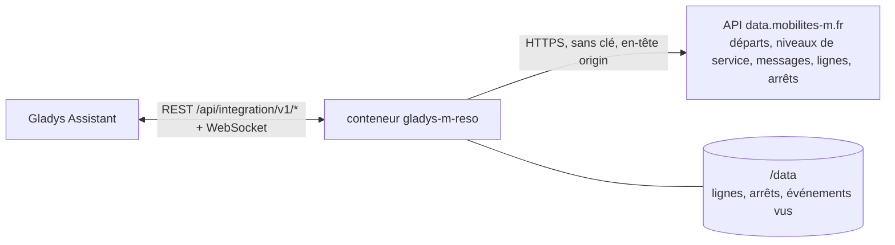
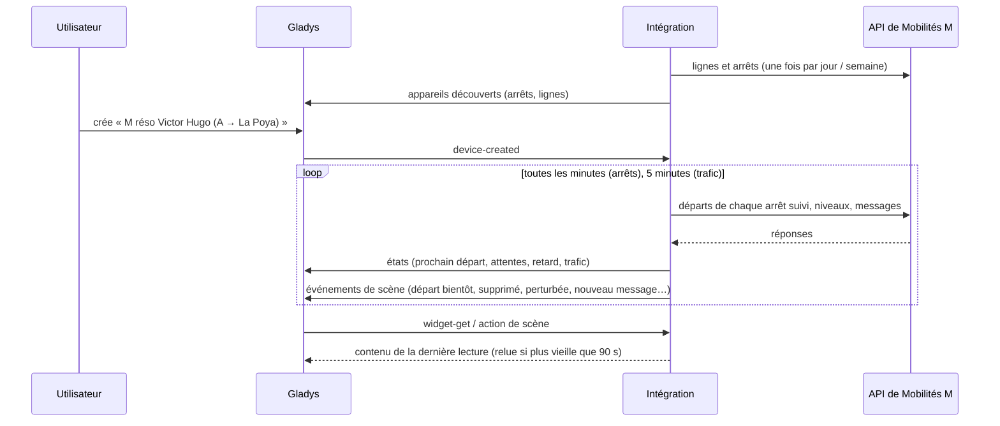
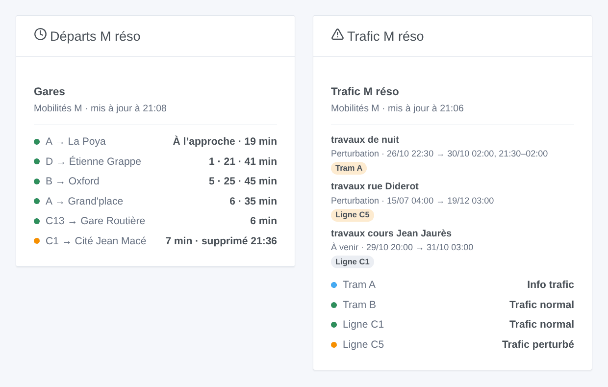

# Gladys M réso

[English](README.md) · **Français** · [Deutsch](README.de.md) · [Español](README.es.md)

[](LICENSE)
[](https://github.com/William-De71/gladys-m-reso/releases)
[](https://github.com/William-De71/gladys-m-reso/actions/workflows/release.yml)
[](https://gladysassistant.com)


Intégration externe [Gladys Assistant](https://gladysassistant.com) pour **M réso**, les trams et bus de Grenoble : les prochains départs en temps réel à vos arrêts, avec leur retard et les courses supprimées, et le trafic de vos lignes, avec scènes et widgets de tableau de bord. Elle lit l’open data officiel de Mobilités M (SMMAG), sans compte ni clé.

Documentation utilisateur : [English](docs/en.md) · [Français](docs/fr.md) · [Deutsch](docs/de.md) · [Español](docs/es.md).

> Intégration communautaire, ni affiliée ni approuvée par le SMMAG, M réso ou les exploitants des réseaux de Mobilités M.

## Fonctionnalités

- **Un appareil par arrêt suivi** (trois dans le formulaire, jusqu’à 10 de plus avec le bouton **Ajouter un arrêt**), saisi par son nom — avec sa commune quand deux communes le partagent — ou par son code, et filtré par **ligne** et **direction** : prochain départ, attente des deux prochains départs, retard du prochain.
- **Un appareil par ligne suivie** (six au plus), M réso et les autres réseaux de Mobilités M (Cars Région, Pays Voironnais, Grésivaudan…) : son niveau de service (normal, info trafic, perturbé, très perturbé) et les messages trafic en cours.
- **Temps réel** : l’heure estimée et le retard quand le véhicule est suivi, l’horaire théorique sinon (signalé comme tel), les courses supprimées.
- **5 déclencheurs de scène**, **2 actions de scène** et **2 widgets** (ci-dessous).
- Une requête par arrêt suivi, toutes les minutes par défaut (30 s à 5 min, toutes les 10 min la nuit quand rien n’est annoncé), le trafic toutes les 5 minutes ; lignes et arrêts des réseaux gardés dans `/data`.
- Boutons de configuration : tester la connexion, chercher un arrêt (commune, code, lignes), ajouter / retirer / lister des arrêts, diagnostic.
- Quatre langues partout : anglais, français, allemand, espagnol.

## Fonctionnement




Au démarrage, l’intégration lit les lignes (`/routers/default/index/routes`) et les arrêts (`/points/json?types=clusters`, les « zones d’arrêt » : un nom dans une commune) de tous les réseaux du territoire. Elle résout ensuite ce que vous avez saisi : « A » est la ligne de tram `SEM:A`, « C1 » la Chrono de M réso (le TER « C1 » par son code), « Chavant » l’arrêt `SEM:GENCHV`. Puis elle lit les prochains départs de chaque arrêt suivi (`/clusters/<code>/stoptimes`, courses supprimées comprises) à son propre rythme, une requête par arrêt, et garde ceux de la ligne et de la direction choisies ; toutes les 5 minutes, elle lit les niveaux de service (`/dyn/ligne/json`) et les messages trafic (`/dyn/evtTC/json`). Chaque lecture est comparée à la précédente pour lancer les déclencheurs de scène.



### Transport

Cloud uniquement (`"transports": ["cloud"]`) : le catalogue affiche le badge cloud. L’intégration contacte `data.mobilites-m.fr` ; seuls les arrêts suivis sont demandés. Il n’y a pas d’alternative locale, donc pas de bouton « Préférer la connexion locale ».

## Appareils et fonctionnalités

| Appareil            | Fonctionnalité              | Catégorie / type             | Valeurs                                    |
| ------------------- | --------------------------- | ---------------------------- | ------------------------------------------ |
| M réso \<arrêt\>    | Prochain passage            | `text` / `text`              | « A → La Poya · 3 min (+2 min de retard) » |
| M réso \<arrêt\>    | Attente, attente du suivant | `duration` / `integer`       | 0 … 180 min                                |
| M réso \<arrêt\>    | Retard du prochain passage  | `duration` / `integer`       | 0 … 120 min                                |
| M réso tram / ligne | Trafic                      | `text` / `text`              | « Trafic perturbé : travaux rue Diderot »  |
| M réso tram / ligne | Infos trafic en cours       | `counter-sensor` / `integer` | 0 … 20                                     |

La nuit, sans aucun départ, les attentes gardent leur dernière valeur (un 0 annoncerait un tram maintenant) ; le retard n’est publié que pour un départ suivi en temps réel.

## Déclencheurs, actions et widgets



**Déclencheurs de scène** (une fois par changement ; la première lecture sert de référence et ne déclenche rien) :

- **Départ bientôt** : un départ à un arrêt suivi part dans 2, 3, 5, 10, 15 ou 20 minutes, selon son heure estimée en temps réel. Filtres : arrêt, minutes.
- **Départ supprimé** : une course de l’heure à venir à un arrêt suivi est supprimée. Filtre : arrêt.
- **Ligne perturbée** : le niveau de service d’une ligne suivie devient perturbé ou très perturbé. Filtre : ligne.
- **Fin de perturbation** : la ligne retrouve un niveau de service normal. Filtre : ligne.
- **Nouveau message trafic** : Mobilités M publie un message sur une ligne suivie, en cours ou à venir. Filtres : ligne, type (information, perturbation, forte perturbation).

**Actions de scène** : **prochains départs** d’un arrêt (ligne, destination, attente, heure, temps réel ou non, retard, le suivant, une phrase) et **trafic d’une ligne** (état, messages, dernier message, une phrase).

**Widgets** : **Départs M réso** (un arrêt suivi, plusieurs dans une même liste, ou n’importe quel arrêt saisi dans les réglages) et **Trafic M réso** (les lignes suivies, celles saisies, ou les cinq lignes de tram par défaut).

Exemples :

- Quand **le tram A vers La Poya part de Victor Hugo dans 5 minutes** → allumer la lampe de l’entrée en vert.
- Quand **un départ de votre arrêt est supprimé** ou que **le C1 est perturbé** → envoyer `{{triggerEvent.data.summary}}` sur votre téléphone.
- Chaque jour de semaine à 7 h 30 → **lire les prochains départs** de votre arrêt et faire dire le `summary` par l’enceinte de la cuisine.

## Prérequis

- Gladys Assistant **5.3.0** ou plus récent (widgets et déclencheurs de scène des intégrations externes, mots-clés et pays du catalogue de Gladys 5.3). Les instances plus anciennes ne peuvent pas installer l’intégration.
- Rien d’autre : l’open data de Mobilités M ne demande ni compte ni clé.

## Installation

- **Depuis le store** de Gladys (Intégrations → Intégrations externes), en un clic, une fois indexée.
- **Depuis l’URL du dépôt** : `https://github.com/William-De71/gladys-m-reso`.
- **Mode développeur** : construire l’image en local (`docker build -t gladys-m-reso .`) et l’installer depuis Gladys.

## Configuration

| Champ              | Description                                                                          |
| ------------------ | ------------------------------------------------------------------------------------ |
| Arrêt (1 à 3)      | Un nom (« Chavant », « Grenoble Hôtel de Ville ») ou un code (« SEM:GENCHV »).       |
| Ligne              | « A », « C1 », « 16 ». Vide : toutes les lignes de l’arrêt.                          |
| Direction          | Des mots de la destination : « La Poya », « Fontaine \| Seyssins ». Vide : les deux. |
| Lignes suivies     | Six au plus, séparées par des virgules : « A, B, C1, 16 ».                           |
| Lecture des arrêts | 30 s, 1 min (par défaut), 2 min ou 5 min.                                            |
| Langue des textes  | Noms des appareils, résumés et sorties des scènes.                                   |

Boutons : **Tester la connexion**, **Chercher un arrêt** (commune, code et lignes de chaque arrêt trouvé), **Ajouter un arrêt**, **Retirer un arrêt**, **Lister les arrêts** (les arrêts au-delà des trois du formulaire, gardés dans la configuration de Gladys) et **Diagnostic** (écrit les arrêts, lignes, derniers départs, erreurs et requêtes dans l’onglet Journaux).

## Utilisation

1. Saisissez un à trois arrêts — davantage avec **Ajouter un arrêt** — (avec leur ligne et leur direction si vous le souhaitez) et les lignes à suivre, puis enregistrez.
2. Dans l’onglet **Découvrir**, créez les appareils « M réso … ».
3. Ajoutez les widgets **Départs M réso** et **Trafic M réso** à un tableau de bord, et créez des scènes avec les déclencheurs ci-dessus.

## Développement

```bash
npm install
npm test                       # node --test, ne touche jamais le réseau
npm run lint && npm run format:check
npx github:GladysAssistant/integration-store . --skip-image-check
scripts/build-cover.sh         # cover.jpg depuis docs/assets/cover.svg
docs/illustrations/render.sh   # docs/assets/widgets.<langue>.png
node .github/scripts/release.mjs next
```

En local, le SDK lit `GLADYS_HOST_API_URL`, `GLADYS_INTEGRATION_TOKEN` et `GLADYS_INTEGRATION_SELECTOR` ; `MRESO_API_URL` dirige l’intégration vers une autre racine d’API (un bouchon) ; `DEBUG=gladys-integration-sdk` affiche les journaux du SDK et vérifie chaque contenu de widget. Les tests utilisent de vraies réponses de l’API de Mobilités M, réduites (`test/fixtures/`, ODbL). Les règles du projet sont dans [CLAUDE.md](CLAUDE.md).

## Processus de release


Chaque fusion sur `main` lance la CI, puis calcule la version à partir des [Conventional Commits](https://www.conventionalcommits.org/) depuis le dernier tag : `feat` → mineure, `fix` / `perf` → correctif, `!` ou `BREAKING CHANGE` → majeure (une mineure sous 1.0.0) ; `docs`, `chore`, `ci`, `test`, `style`, `refactor`, `build` seuls ne publient rien. La section du changelog est générée, le tag poussé, l’image multi-architecture construite, puis `main` reçoit le commit de release, la GitHub Release est créée et un dernier job vérifie l’image publique, le validateur du store et le topic.

- Le titre de la pull request devient le commit squash, puis la ligne du changelog : écrivez-le en anglais, pour l’utilisateur (`pr-title.yml` le vérifie). Ne modifiez jamais `CHANGELOG.md` à la main.
- 1.0.0 est une décision : Actions → Release → Run workflow avec `release-as: 1.0.0`. `dry-run` montre la version et les notes sans rien publier.
- **Branche protégée** : la release pousse son commit sur `main` avec `GITHUB_TOKEN`. Avec un ruleset sur `main` plus strict que « pas de suppression, pas de force-push », ajoutez GitHub Actions à sa liste de contournement (ou poussez via une GitHub App), sinon le job de publication échoue avec des instructions.
- Après la première release, rendez public le paquet `ghcr.io` (Package settings → Change visibility), sinon Gladys ne peut pas le télécharger.

## Dépannage

Voir [docs/fr.md](docs/fr.md#dépannage). Signalez les problèmes avec les versions de Gladys et de l’intégration, l’arrêt ou la ligne concernés, et les lignes du bouton **Diagnostic**.

## Contribuer

Issues et pull requests bienvenues. Lancez `npm run format:check && npm run lint && npm test` avant d’ouvrir une pull request, et ne changez aucun identifiant externe ni aucune clé stockée (voir [CLAUDE.md](CLAUDE.md)).

## Sécurité

Voir [SECURITY.md](SECURITY.md) : signalez les vulnérabilités en privé. L’intégration n’a besoin d’aucun secret : elle ne lit que des données ouvertes publiques, et tourne en lecture seule, en utilisateur non root, dans son conteneur.

## Captures à venir

Les images ci-dessus sont des illustrations, pas des captures d’écran. Les vraies captures iront dans `docs/assets/screenshots/` (PNG, 1280 × 800) : `configuration.png`, `discovery.png`, `device.png`, `scene.png`.

## Licence

[Licence Apache 2.0](LICENSE) — voir aussi [NOTICE](NOTICE). Les départs, lignes, arrêts, niveaux de service et messages trafic sont des données ouvertes de Mobilités M (SMMAG) sous [Open Database License (ODbL)](https://opendatacommons.org/licenses/odbl/1-0/) : les widgets affichent la source et l’heure de chaque lecture. Merci à la documentation et au SDK de Gladys, et au SMMAG de publier ces données en temps réel.
